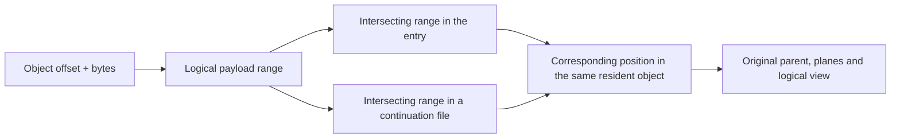

# NInfer v3 Container Specification

V3 stores a compact model instance configuration, the actual objects, the logical bindings and the
required resources. Mathematical formulas, component handoffs and state programs are defined by the
model code. A reader and a writer can implement the file organization and references independently
from this document alone; the binder of the corresponding architecture then interprets the logical
parameters and configuration.

An artifact has a fixed entry and a single directory. When small it is one `.ninfer` file; when
large it consists of the entry plus continuation files. Objects use a unified logical payload
offset, and file sharding preserves each object's encoding, layout and binding relationships.

## 1. Contracts and notation

| Content | Authority |
|---|---|
| File headers, JSON, objects and references, file sharding, v3 persistent names | This document |
| Fixed math, compact config, logical parameter shapes, component inputs | The corresponding architecture's [configuration](../../src/models/qwen3_5/config.h) and [binding](../../src/models/qwen3_5/load/) |
| Numeric decoding of formats, valid codes/scales | [Numeric formats](tensor-formats.md); for persistent names see Section 6 |
| Planes, packing, internal padding and encoded size of layouts | [Storage layouts](storage-layouts.md); for persistent names see Section 6 |
| Native Op parameters, supported range, numerics and scratch | The corresponding Op contract |
| Residency, state, capacity, CUDA Graph and result publication | [Engine architecture](engine-architecture.md) and its resource contracts |

All integers in this document are exact integers; booleans and floating-point values are
interpreted according to their respective types.

| Notation | Definition |
|---|---|
| U64 | An integer in `0..18446744073709551615` |
| PositiveU64 | A U64 strictly greater than zero |
| ID | A nonempty UTF-8 string without U+0000, compared exactly by its original character sequence |
| Shape | A list of positive integers of length `0..16`; the empty list `[]` denotes a scalar |
| `elements(shape)` | 1 for an empty shape, otherwise the product of the dimensions |
| `[begin,end)` | A half-open interval, closed on the left and open on the right |
| `align_up(x,a)` | `ceil_div(x,a)*a` |

Products, prefix sums, offset additions and alignment results must lie within the U64 range. Actual
I/O and memory consumers check their own address ranges. The file format uses 64-bit sizes; an
Op's actual shape support is determined by its call entry point.

Header integers are little-endian. JSON uses UTF-8, and member names within each object are unique.
Member order, ordinary string escapes and JSON whitespace keep their standard JSON meaning. Size
fields use JSON integers; real-valued model parameters are stored and parsed with the precision
their contract requires.

The field tables list the complete member set of the generic records and which members are optional.
A generic field that is not listed is a schema error; `config` is left to the architecture to
interpret, and `metadata` and `provenance` are the open information objects defined in Section 10.

## 2. File set and address space

### 2.1 Entry and continuation files

The writer generates the file set from the given entry output path. When the entry is
`example.ninfer`, the file names are uniformly:

```text
example.ninfer
example.ninfer.part-0001
example.ninfer.part-0002
```

The entry holds the header, the JSON directory and the first payload segment. Each continuation
file holds its own small header and the subsequent payload. The writer names continuation files
`<entry file name>.part-<number>`, where the entry file name includes its original extension; the
number equals the continuation file's index in the `files` table, starts at 1, is written in
decimal, and is left-padded with zeros to four digits when it has fewer than four digits; four or
more digits are written in full. Continuation file names are derived automatically by this rule,
with no separate naming parameter; the actual file name is written to `files[i].path`.

Users always open the entry. The reader locates continuation files by the file names recorded in
the `files` table; the naming rule above for generation is not a validation condition on read, and
any file name in the directory that satisfies the path rules of Section 3.3 can be read.

All files of one set have the same 16-byte `artifact_id`. It is used to verify that the entry and
continuation files belong together; the writer should use a new UUID each time it generates a new
file set. It identifies the container set; the choice of model implementation is still based on
the architecture and instance parameters. The header stores the raw 16 bytes; when printed it can
be shown as 32 lowercase hexadecimal characters.

### 2.2 Logical payload

Let `files[i].payload_bytes = B_i` and define:

```text
P_0 = 0
P_i = sum(B_j, j < i)
payload_bytes = sum(B_i)
```

File i holds `[P_i,P_i+B_i)` of the logical payload. These form an ordered set of contiguous
intervals. An object's `offset` is always relative to this logical payload; each file's header,
JSON and the alignment padding before the payload are not counted in the logical payload.



An object may cross file boundaries. It is still one object, and its format/layout is computed from
the logical start of the complete object. A shard boundary may also fall inside a plane; reads and
copies preserve the original byte order.

### 2.3 Default 32 GB shard limit

By default the writer uses a per-file size limit of **32 GB = 32,000,000,000 bytes**, which counts
the file header, the JSON, the alignment padding before the payload and the file's payload. GB here
is a decimal unit.

The writer may accept another explicit limit. The limit is a generation policy; the files store
only the actual sharding result, and the reader reads according to the directory.
If `entry_payload_start + payload_bytes <= limit`, the writer generates only the entry file.
When the limit is exceeded, the entry first holds the first segment, and the remaining data goes
into continuation files in order.

For a given entry_payload_start, the current writer's shard capacities are:

```text
entry_capacity = floor((limit - entry_payload_start) / 4096) * 4096
part_capacity  = floor((limit - 4096) / 4096) * 4096
```

When sharding is needed, the writer first checks that the limit is large enough to hold the headers
and that both capacities are positive; every segment except the last is filled to capacity, and the
last segment holds the remaining bytes. The number of shards is determined by the data size and the
capacities.
This placement keeps the logical start of each segment 4096-byte aligned, which suits direct I/O;
the reader's range mapping also accepts other positive-length segmentations that satisfy this
specification.

## 3. Binary framing

### 3.1 Entry header

The entry header has a fixed length of 32 bytes.

| Offset | Bytes | Field | Encoding and meaning |
|---:|---:|---|---|
| 0 | 8 | magic | `4e 49 4e 46 45 52 00 03`, i.e. `NINFER`, a zero byte, version 3 |
| 8 | 8 | json_bytes | Little-endian PositiveU64; length of the complete UTF-8 JSON text |
| 16 | 16 | artifact_id | Raw bytes of the file set identifier |

```text
json_offset         = 32
metadata_end        = 32 + json_bytes
entry_payload_start = align_up(metadata_end, 4096)
entry_file_bytes    = entry_payload_start + files[0].payload_bytes
```

The reader verifies the complete magic, reads the JSON at `[32,metadata_end)`, and checks that the
actual file length equals entry_file_bytes. `[metadata_end,entry_payload_start)` is the file
alignment padding, which the writer fills with zeros.

Valid trailing JSON whitespace is counted in json_bytes. The writer can use it to reserve a fixed
amount of directory space and then lay out the payload capacity in the entry; this avoids repeatedly
moving the payload when the length of the shard table changes. The reader parses this text as
standard JSON.

### 3.2 Continuation header

The continuation header is also 32 bytes, and the payload always starts at file offset 4096.

| Offset | Bytes | Field | Encoding and meaning |
|---:|---:|---|---|
| 0 | 8 | magic | `4e 49 4e 50 52 54 00 03`, i.e. `NINPRT`, a zero byte, version 3 |
| 8 | 8 | part_index | Little-endian PositiveU64; the corresponding index in the `files` array |
| 16 | 16 | artifact_id | Byte-for-byte identical to the entry's |

```text
part_payload_start = 4096
part_file_bytes    = 4096 + files[part_index].payload_bytes
```

The writer fills `[32,4096)` with zeros. When opening a continuation file, the reader verifies the
magic, part_index, artifact_id and actual length.
The entry and continuation files have different magics; a continuation file takes part in reading
through the entry's directory.

### 3.3 File directory

The root field `files` is a nonempty array. Element 0 of the array describes the entry; the
remaining elements describe continuation files.

| Field | Type | Meaning |
|---|---|---|
| path | null for element 0; a string for the others | Sibling file name, relative to the entry's directory |
| payload_bytes | PositiveU64 | Number of logical payload bytes held by this file |

```json
[
  {"path": null, "payload_bytes": 31999934464},
  {"path": "example.ninfer.part-0001", "payload_bytes": 4096}
]
```

A continuation path is a nonempty file name taken as its original character sequence; it contains
no `/`, `\\` or U+0000, and the name is not equal to `.` or `..`. Continuation file names are all
distinct and differ from the name of the entry file opened this time. The directory can be moved as
a whole.

The numeric example above takes entry_payload_start=65536, so the entry file is exactly
32,000,000,000 bytes. The second file's actual size is 8192 bytes.

## 4. JSON directory

### 4.1 Root record

| Field | Type / requirement | Meaning |
|---|---|---|
| components | Object, required, contains text | The model components actually provided and their compact configuration |
| objects | Nonempty Array<ObjectDescriptor>, required | Physical objects ordered by logical payload offset |
| bindings | Object, required | Map from full logical parameter names to Bindings |
| uses | Array<Use>, required | Compute permissions and auxiliary inputs, expanded per mathematical use site |
| files | Nonempty Array<File>, required | The file directory of Section 3.3 |
| metadata | Object, optional | Public name and other Section 10 information |
| provenance | Object, optional | Source, training pairing and conversion notes |

The framing version already fixes the JSON syntax, so the root record uses the fields above
directly. See Section 12 for complete JSON examples.

### 4.2 Component records

The keys of `components` are component IDs. `text` is the main model; the current optional
components use `vision`, `mtp`, `dflash` and `dflash2`. New concrete architectures or backends can
use the same record structure, with the corresponding compiled code interpreting their IDs and
config.

| Field | Type / requirement | Meaning |
|---|---|---|
| config | Object, required | Architecture identification and this component's few instance parameters |
| target | Component ID, optional | The target component this component is associated with |
| resources | Object, optional | Map from resource roles to resource object IDs; omitted means an empty map |
| proposal | Object, optional, text only | Optional proposal output representation attached to the main model; see Section 9.2 |

Config uses the corresponding architecture's standard architectures/model_type and retained fields.
For example, Qwen Text contains architectures, model_type, hidden_size and so on; Vision uses its
own standard model_type; the current Qwen MTP config needs only architectures, and its geometry is
obtained through target.
Source adaptation interprets upstream organization such as `text_config` and `vision_config`, then
writes the normalized result into the corresponding component's config; a component's target,
resources and proposal are placed separately according to the field table in this section.

```json
{
  "config": {"architectures": ["Qwen3_5MTP"]},
  "target": "text"
}
```

A target reference must resolve to an existing component; its mathematical relationship is checked
by the architecture binder. Currently the target of both Vision and spec is text. Fixed feature
capture positions, state operations and feature preparation flows are defined by that component's
code.

Declaring a component means the artifact provides it. Startup options decide which components are
enabled for this run; text, the selected components and the data they actually share take part in
loading. The writer is responsible for the data completeness of the declared components; the binder
checks the mathematical and data requirements of the features selected at startup.

## 5. Physical objects

### 5.1 Tensor objects

| Field | Type | Meaning |
|---|---|---|
| id | ID | Object reference name, unique within this artifact |
| kind | `tensor` | Object kind |
| shape | Shape | Logical shape of the stored object, using C-order element coordinates |
| format | ID | Numeric format from Section 6 |
| layout | ID | Layout from Section 6 |
| offset | U64 | Byte offset of the object's start in the logical payload |
| bytes | PositiveU64 | Number of bytes of the object's complete encoding |
| divisors | PositiveU64 | Optional, default 1. Number of independently quantized source matrices stacked into this plane; each source matrix holds its own NVFP4 weight divisor, and the plane's rows are divided evenly among them. Only `nvfp4` and `block_scale_k16_m128x4_v1` allow values greater than 1 (the routed expert bank of Qwen4Exp) |

```json
{
  "id": "w.attn.qk",
  "kind": "tensor",
  "shape": [7168, 5120],
  "format": "q4_g64_fp16",
  "layout": "row_split_k128_v1",
  "offset": 0,
  "bytes": 19496960
}
```

Shape describes the object's logical value domain; the layout itself computes the physical padding,
planes and encoded size.
For example, the K-dimension padding of Q4 is computed by row_split_k128_v1. An object can hold
multiple projections or multiple experts; their mathematical use is given by the bindings in
Section 7.

An encoded object contains all planes and object-level scalars its codec/layout requires. The block
scales and weight divisor of the existing NVFP4 are inside the object; the row scales of the
existing per-row FP8 are inside the object too.
The separate pointers an Op needs are obtained from this object's defined layout. The activation
divisor of a use site, by contrast, is bound separately; see Section 8.

### 5.2 Resource objects

| Field | Type | Meaning |
|---|---|---|
| id | ID | Shares a single unique namespace with all tensor/resource objects |
| kind | `resource` | Object kind |
| encoding | `raw_bytes_v1` | The complete range is raw resource bytes |
| offset | U64 | Logical payload byte offset |
| bytes | PositiveU64 | Raw resource length |

```json
{
  "id": "r.chat_template",
  "kind": "resource",
  "encoding": "raw_bytes_v1",
  "offset": 19496960,
  "bytes": 4096
}
```

How a resource is interpreted is determined by the role it is used in. Content rules for JSON, UTF-8
templates or other resources belong to the corresponding Frontend; the resource object itself only
provides raw bytes.

### 5.3 Object ranges and sharing

All objects are ordered by increasing offset, have unique IDs, and have byte ranges that do not
overlap and lie within the logical payload.
A tensor offset satisfies the layout's 256-byte object alignment; the alignment of a raw resource
is 1. Tensor bytes equals the encoded size of the corresponding `(format,layout,shape)`.

Gaps between objects and unreferenced logical payload bytes at the end have no loading semantics. A
regular writer leaves space only for alignment and truncates at the end of the last object. Padding
inside a completely encoded object continues to follow its layout contract.

When several logical uses share one object, they all reference the same ID; the materializer uses
this to create the backing once. Objects not referenced by the uses of this run stay non-resident.
Object IDs, ordering and file positions take part only in loading and diagnostics; weight
references during execution are resolved once by the binder.

The complete parent is the unit of materialization and residency. Multi-device placement can split
one parent by rows or columns into per-device shards (see 11.2), with the encoding format
unchanged. The converter must organize the backbone parameters, the private parameters of each
independently enableable component, and the private data of each independently selectable proposal
representation into separate objects, so that the private data of disabled features stays
non-resident. Truly shared data can be referenced as the same object by different features, for
example Text and MTP using the same embedding/head, or a proposal referencing an existing
representation of the Text head.
Concatenating Text parameters and MTP private projections into one parent does not conform to this
generation rule; placing their separate objects in the same file does. The converter checks object
merge boundaries against the architecture's feature dependencies; the reader still reads according
to the directory.

## 6. V3 numeric format and layout names

### 6.1 Numeric formats

V3 canonical names use lowercase snake_case. Each name refers to one codec in the code with an
exact meaning; the fixed group size, scale type and decoding rules are defined directly by that
codec.

| Name | Numeric meaning |
|---|---|
| bf16 | Raw Bfloat16 word |
| fp32 | Raw IEEE binary32 word |
| int32 | Signed 32-bit integer |
| q4_g64_fp16 | Signed 4-bit codes, G64, FP16 multiplier |
| q5_g64_fp16 | Signed 5-bit codes, G64, FP16 multiplier |
| q6_g64_fp16 | Signed 6-bit codes, G64, FP16 multiplier |
| q8_g32_fp16 | Codes `[-127,127]`, G32, FP16 multiplier |
| nvfp4 | E2M1 codes, G16 E4M3FN block scale, FP32 weight divisor |
| fp8_e4m3fn_row_bf16 | E4M3FN codes, one BF16 multiplier per row |

The trailing FP16/BF16 in a quantized name denotes the scale type. Activation compute permissions
are expressed in uses.
Code ranges, special floating-point values, rounding and exact reconstruction are interpreted
according to the [numeric contract](tensor-formats.md).
In particular, NVFP4 reconstruction uses `code_value * block_scale / weight_divisor`, and per-row
FP8 uses its defined `code_value * row_scale` reconstruction rule.

When the encoder or calibration process changes for the same numeric meaning, the format name stays
the same, and the generation method is recorded in recipe/provenance.

### 6.2 Layouts and resource encoding

| Name | Currently allowed format / shape | Object alignment |
|---|---|---:|
| contiguous_le_v1 | bf16/fp32/int32, rank 0..16 | 256 |
| row_split_k128_v1 | q4_g64_fp16, q5_g64_fp16, q6_g64_fp16, q8_g32_fp16, positive rank-2 `[N,K]` | 256 |
| block_scale_k16_m128x4_v1 | nvfp4, `N%128=0`, `K%64=0` | 256 |
| row_scale_v1 | fp8_e4m3fn_row_bf16, positive rank-2 `[N,K]` | 256 |
| raw_bytes_v1 | Resource, nonempty byte string | 1 |

Byte packing, planes, internal padding, swizzle and the encoded-size formulas are defined by the
[storage layout contract](storage-layouts.md).

The v1 of a layout is the layout's own version, managed separately from container v3. A different
byte arrangement is added by adding a corresponding layout definition; a new actual numeric encoding
capability is added by adding a codec definition, and ordinary object records keep using the same
structure.

## 7. Logical parameter bindings

### 7.1 Two kinds of Binding

The root `bindings` is a map from full logical parameter names to Bindings. The names are defined
by the architecture code, for example `text/layers/3/attention/query`. Logical parameter shapes are
derived from the code and the compact config.
Each logical name corresponds to one Binding. The architecture defines different logical names for
uses of a trained parameter that need independent representations; each Binding can reference the
same object or different objects, and training-time sharing relationships are defined by the
architecture/config.

A Binding has two mutually exclusive forms:

| Form | Complete fields | Meaning |
|---|---|---|
| Whole object | `object: ID` | The entire tensor object corresponds to one logical parameter; object.shape equals the parameter shape |
| Ordered parts | `parts: nonempty Array<Part>` | Concatenates the logical elements of the parts in order, covering the parameter's C-order element sequence |

The complete fields of a Part are:

| Field | Type | Meaning |
|---|---|---|
| object | Tensor object ID | Physical parent of the part |
| range | `[U64,U64]` | Flat interval `[begin,end)` over the object's logical elements |

Range satisfies `0<=begin<end<=elements(object.shape)`. The sum of the parts' element counts equals
the logical parameter's element count.
The array order is the target element order; the target offset is the accumulated length of the
preceding parts.
Ranges of the same object can be referenced by different uses or different parts; what the
repetition actually means is interpreted by the corresponding model math.

```json
{
  "text/final_norm": {"object": "w.final_norm"},
  "text/layers/3/attention/query": {
    "parts": [{"object": "w.attn.qk", "range": [0, 31457280]}]
  }
}
```

**Range is in units of logical elements; object.offset/bytes are in units of bytes.** The logical
element sequence excludes padding introduced by the layout and does not treat quantization scales
as weight elements. It keeps the parent's numeric decoding rules.

### 7.2 Axes, reshape and row order

C-order means the last dimension varies fastest. For shape `[N,K]`, element coordinate `(n,k)`
corresponds to `n*K+k`. Consecutive complete rows `[r0,r1)` therefore correspond to range
`[r0*K,r1*K)`.

The whole-object form expresses a complete binding with the same shape. The ordered-parts form
interprets the target shape through an explicit element correspondence, and can express contiguous
reshapes, subregions of a fused parent, split objects and row-block reordering.
For example, one expert's range in a rank-2 expert bank can correspond to a rank-2 logical
projection; higher-order logical axes are interpreted by that parameter's own shape.

If a parent stores two groups of projections interleaved, the converter can write out a Part for
each head's contiguous region in order. Regular artifacts preferably prepare, at conversion time, a
grouping and row order that existing Ops can easily consume.

### 7.3 Binding to native Ops

The binder checks logical coverage and correspondence, and keeps each Part's parent, original shape,
format/layout, range and owner. One logical parameter can consist of multiple representations; one
native Op can also consume multiple logical parameters.

For example, when Q/K and gate/V come from a q4 and a q5 parent respectively, parameter preparation
can enter the implemented dual-weight entry point; when all four come from the same nvfp4 parent,
it can enter the corresponding single-weight entry point. The code organizes these calls according
to the real grouping, ranges and geometry.

A zero-copy view is determined by the actual layout and the consumer's addressing capability. A
span of logical rows in RowSplit involves several plane ranges, such as base, optional high-bit and
scale; an NVFP4 view also keeps the original parent's scale swizzle and weight divisor. The
materializer uploads the parent's original encoding, and the Op prepares the view it can actually
consume. Work that requires changing the packing or reorganizing the encoding is done by the
converter.

File sharding only affects how parent bytes are fetched. Even if a parent spans multiple files, the
logical references and Op parameter relationships above still hold.

## 8. Use permissions and auxiliary inputs

The root `uses` is an array of Uses, and each `(parameter,input)` combination is unique.
Each Use consumes the Binding its parameter points to; multiple Uses of the same parameter share
that representation, each providing the permission and auxiliary values at its own input position.

| Field | Type / requirement | Meaning |
|---|---|---|
| parameter | ID, required | An existing logical parameter name in the root bindings |
| input | ID, required | The full mathematical input position defined by the architecture code |
| activation_policy | Enum, optional | Required for uses that have this permission contract |
| auxiliaries | Object, optional | Map from auxiliary input roles to Bindings; empty when omitted |

The exact spellings of the permissions and their allowed sets are:

| activation_policy | Allowed set |
|---|---|
| A16Only | A16 |
| AllowA8 | A16, A8 |
| AllowA4 | A16, A8, A4 |

The writer writes an explicit result for each projection use site that needs a permission. An
encoder's default rules belong to the recipe and are already expanded once they enter uses. When one
activation quantization is shared, the intersection of the related uses' permissions is used, and
the auxiliary input relationships must be satisfied.

```json
{
  "parameter": "text/layers/3/attention/query",
  "input": "text/layers/3/mixer_input",
  "activation_policy": "AllowA4",
  "auxiliaries": {
    "activation_input_divisor": {"object": "a.attn.query.input_divisor"}
  }
}
```

The auxiliary object in this example is `format=fp32, layout=contiguous_le_v1, shape=[]`, and its
value is checked to be positive and finite as the consumer requires. A Part can also reference a
single element in an FP32 vector, keeping the same scalar meaning.
The expected shape, type and role of an auxiliary Binding are defined by the corresponding use
contract.

DFlash/DFlash2 query K/V use `attention/key` and `attention/value`, and context K/V use
`attention/context_key` and `attention/context_value`, each with its own Binding and Use.
The two groups of bindings can share a parent region or choose their representations independently;
see Section 12.5. The weight divisor and block scales belong to the weight codec; the activation
divisor belongs to the use site.

## 9. Resources and optional output representations

### 9.1 Frontend resource references

The keys of a component's resources are interpreted by the corresponding Frontend contract; common
upstream file roles can use the original file names directly:

```json
{
  "tokenizer.json": "r.tokenizer",
  "tokenizer_config.json": "r.tokenizer_config",
  "chat_template.jinja": "r.chat_template",
  "generation_config.json": "r.generation_config"
}
```

These values all reference resource objects. They are object references, and the actual resource
bytes are stored with the artifact. Vision's processor resources can be placed in vision.resources
and are obtained according to dependencies when the feature is enabled.

V3 can carry a custom chat template in the corresponding resource object. The resource stores raw
bytes; recognition and rendering of the template are determined by the actual capabilities of the
current [Frontend](../../src/models/qwen3_5/frontend/chat_template.cpp).
The complete tokenizer resources together determine the token domain, while the fixed model config
keeps its own weight vocab_size.

### 9.2 Optional proposal output representation

The complete record of `text.proposal` is:

| Field | Type / condition | Meaning |
|---|---|---|
| domain | `full` or `indexed` | Proposal row domain |
| rows | PositiveU64, indexed only | Ns; number of logical rows of the indexed head |

Its parameters are still placed in the root bindings, using the defined names `proposal/head` and
`proposal/token_ids`. The row count of full is taken from the Text vocab_size; indexed requires an
explicit token ID mapping. The main output head is always provided by Text's own bindings. When
proposal is omitted, existing backends, according to their code, use the target's full output
representation.

## 10. Instance information and provenance

`metadata` is an open JSON object; the optional `name` is a nonempty public name string, and the
other members are for display and tool records. `provenance` is an open JSON object that can store
the source checkpoint/revision, component training pairings, encoder/recipe notes and conversion
information. When omitted, both are treated as empty objects.

The values, permissions and resources needed for execution go into config, objects, bindings, uses
and resources respectively.
The Frontend reads EOS from generation_config; mode sampling presets are provided by the
architecture implementation and can be overridden by the application and requests. Sampling values
in the resources are stored as is, and the current Frontend does not use them to replace the mode
presets; see the [CLI sampling notes](../cli.md).
Provenance records where the training pairing comes from; the binder checks the component's actual
target, dimensions and input relationships; quality and acceptance rate are established by
evaluating the artifact.

`artifact_id` identifies the shard set; the public name carries product semantics; the
architecture and config select the model implementation; the object bindings give the actual
representation. Each consumer reads each of them for that purpose.

## 11. Reading, writing and error boundaries

### 11.1 Generic reader

The reader first reads the entry header and JSON and performs the following structural checks:

1. Framing, field sets, types, unique members and integer ranges.
2. Order, paths, positive lengths and logical prefix sums of Files; the actual length of the entry.
3. Object IDs, shapes, byte ranges, order and non-overlap.
4. Binding/Use/resource/target references exist, referenced objects are of the correct kind, and
   Part ranges are valid.

The reader can keep not-yet-interpreted architecture config and format/layout names for inspection.
When a tensor needs to be read, the generic codec/layout facilities parse its format and verify the
encoded size and alignment; selected resources are read according to their encoding. An unknown
encoding is reported when interpretation of that object is actually requested.

A complete distribution contains all files declared in the directory. A run opens only the files
involved in the selected objects; the other continuation files can remain unfetched.
If any needed segment is missing, a header's ownership is wrong or a length does not match, the
related read fails.
When a component is disabled, the read range is decided by the selected requirements, and other
objects in the same file stay un-uploaded.

### 11.2 Range reads and materialization

For a logical read `[offset,offset+length)`, take its intersection with each file's payload range
in order.
The read range must lie entirely within `[0,payload_bytes)`; when length=0, offset may be at the end
and an empty result is returned.
A range read must obtain all declared bytes; a premature EOF or I/O failure within the declared
range is handled as a read error.
If an intersection is `[a,b)`, the corresponding read is:

```text
source_file_offset = file_payload_start(i) + (a - P_i)
destination_offset = a - offset
copy_bytes          = b - a
```

The I/O layer can further cut these segments into transfer blocks and write them at their original
offsets into the same destination object. File headers and file alignment padding are not copied;
cross-file data is handed to the materializer through the range mapping above.

The materializer deduplicates by the parents actually used, arranges device/host backing, and then
obtains typed views.
Uses that need owning Host values, such as auxiliary scalars and indices, can read the corresponding
element range through the Binding, keeping its numeric type.
The reader's JSON and symbol index are used for cold loading; at runtime, resolved references and
direct calls are used.

One load plans device backing for at most two devices (`Binder(reader, device_count)`). Placement
is decided per parent:
`finish()` calls the shard resolver once for each parent that must be resident on a device; object
IDs are still opaque here, and the resolver is provided by the architecture binder based on the
logical parameters it binds. When no resolver is installed, every parent is
`Replicated`, so the single-device plan is byte-for-byte identical to the complete parent layout.

| Placement | What each device holds |
|---|---|
| `Replicated` | One complete parent per device |
| `PrimaryOnly` / `SingleDevice` | Only device 0 / the specified device holds the complete parent |
| `Rows` / `Columns` | Each device holds a concatenation of several ranges along that axis: a separate parent with the same format/layout and a narrowed shape |

Shards are not repacked: a shard's geometry is just the `weight_geometry` of the narrowed shape, and
its content is several byte ranges of the parent encoding (`PlaneCopy`), placed at the shard's own
plane offsets; plane alignment gaps are zero (a device holding a shard creates its arena with
`ZeroFill::Yes`, and zeroing is complete before construction returns).
Split conditions per layout: `contiguous_le_v1` can take multiple ranges in both rows and columns;
`row_split_k128_v1` allows any rows, and columns as a single range in multiples of 128;
`block_scale_k16_m128x4_v1` requires rows in multiples of 128 (scales are interleaved in 128-row
tiles) and columns in multiples of 64, and the weight divisor is copied to every shard;
`row_scale_v1` allows any rows, and when splitting by columns each row's scale is kept whole.

The materializer creates a separate arena, transfer stream and completion event for each device;
each file block is read only once and distributed to the devices that need it.
Destination ranges within one device do not overlap; source ranges of different devices may
overlap: a replicated parent is read from the file only once and then uploaded separately to each
device that holds it.
`bind_view(reference, materialized, device)` maps a Part to the elements held by that device: `Rows`
clips the row range and shrinks the first logical axis, `Columns` accepts only whole-row Parts and
replaces the row width with the shard width; the view of a complete parent is unchanged.

### 11.3 Semantic and support checks

| Case | Owner |
|---|---|
| Header, directory, reference and range errors | Generic reader |
| Encoding geometry of format/layout; actual files missing or mismatched | Object reading and materialization |
| Compact configuration, logical parameter shape/coverage, component relationships, missing data for selected features | The corresponding architecture binder |
| Correctness of codes/scales, encoding padding and source value conversion | Converter, codec and the corresponding validation |
| Insufficient support for actual native parameters or format/layout/shape/phase | Op preparation, capacity query, warmup or execution |
| State storage, actual capacity and lifetime | Program and state implementation |

At runtime, necessary checks are done along the actual consumers, using the already converted
payload; regular uploads rely on the codes/scales contract established by the producer. Numeric
qualification checks follow the existing Op/codec rules.
Warmup conclusions cover the actual execution path, and a failed round is handled by the existing
state transactions.

### 11.4 Writer

The writer receives the already determined component configuration, object/binding/use descriptions
and the actual conversion jobs:

1. Receive the objects the converter organized by the feature dependencies of Section 5.3, obtain
   the encoded size from the codec/layout, and arrange object alignment and order in the logical
   payload.
2. Store the components, bindings, uses and resource references provided by the converter, and
   check the generic directory structure and reference relationships.
3. Choose the limit and the JSON reserved space, generate continuation file names per Section 2.1,
   and compute the files table so that each file's final size satisfies the generation limit.
4. Serialize the JSON; if it exceeds the reserved space, enlarge the space and recompute the shard
   table before starting to write.
5. Generate artifact_id and write the entry and continuation headers.
6. Stream the conversion results by logical payload position; objects that span files continue to
   be written in the same byte order.
7. Verify complete coverage of the declared ranges and the actual file lengths, then publish the
   continuation files first and the entry last.

The current writer completes generation in temporary files; on failure it cleans up the files of
this run and does not overwrite an existing target.
The writer can use trailing JSON whitespace to keep the reserved json_bytes stable. The reservation
policy and transfer block size belong to the implementation; the reader uses only the actual values
of framing and files. When changing the shard limit, the same logical payload can be copied,
keeping the object, binding and use records, and generating a new files table and file set
identifier.

## 12. Concrete examples

### 12.1 Complete Text-only directory

The [single-file example](examples/artifact-v3-text.json) contains a complete small-size Qwen3.5
Dense Text configuration, all logical parameters of one attention and FFN layer, four Text Frontend
resources and all projection use records.
The config and model parameter geometry serve to validate the specification; it is a synthetic
instance, and whether current Ops qualify to execute at this size is judged separately.

The example uses H=128, I=256, Nq=Nkv=1, D=128, L=1, R=248320, and all weight objects use bf16.
Q/K/gate/V are stored in one `[512,128]` parent, and FFN gate/up are stored in one `[512,128]`
parent.
Norm, embedding, main head, attention output and FFN down each bind their own objects.

The lengths of the four resources are taken from locally verified Qwen3.8 Text resources. The
example JSON provides the complete directory; the resource and weight payloads themselves are not
attached to the documentation. Encoding this directory takes json_bytes=65504, padding the actual
JSON with valid whitespace, which gives entry_payload_start=65536. By default the example generates
a single file under the 32 GB limit.

### 12.2 Mixed formats and file sharding for the same model

The [mixed-format sharded example](examples/artifact-v3-mixed-sharded.json) reuses the config,
resource roles and logical parameters above.
Attention changes to a q4 Q/K parent and a q5 gate/V parent; uses keep A16Only.
The example explicitly sets the file limit to 64,000,000 bytes to demonstrate sharding; the
production default is still 32 GB.

The entry payload_start is again 65536, and 4096 for the continuation file. Objects such as
Embedding cross file boundaries; their object shape and format/layout stay complete. The
differences between the two examples lie in the object representations, Part references and the
files table.

### 12.3 Attention with single and dual parents

Taking the actual 27B with H=5120, Q=6144, K=1024, all ranges below are in logical elements:

| Logical parameter | Dual parent: Q4 A + Q5 B | Single parent: FP8 or NVFP4 P |
|---|---|---|
| Query | A `[0,31457280)` | P `[0,31457280)` |
| Key | A `[31457280,36700160)` | P `[31457280,36700160)` |
| Gate | B `[0,31457280)` | P `[36700160,68157440)` |
| Value | B `[31457280,36700160)` | P `[68157440,73400320)` |

A/B both have shape `[7168,5120]`, and P has `[14336,5120]`. Their complete encoded sizes are:

| Object | Format / layout | Bytes |
|---|---|---:|
| A | q4_g64_fp16 / row_split_k128_v1 | 19,496,960 |
| B | q5_g64_fp16 / row_split_k128_v1 | 24,084,480 |
| P | fp8_e4m3fn_row_bf16 / row_scale_v1 | 73,428,992 |
| Alternative representation of P | nvfp4 / block_scale_k16_m128x4_v1 | 41,287,684 |

The binder gets the same four logical parameters; actual Op preparation sees one or two parents.
The NVFP4 activation auxiliary values are associated with the corresponding use sites per Section 8.
If P spans two files, it still provides the same physical parent.

### 12.4 Row-block reordering, reshape and sharing

Suppose a bf16 parent has shape `[8,4]` and stores Q0, gate0, Q1, gate1 in order, two rows each.
Query `[4,4]` and gate `[4,4]` can be represented respectively as:

```json
{
  "query": {
    "parts": [
      {"object": "interleaved", "range": [0, 8]},
      {"object": "interleaved", "range": [16, 24]}
    ]
  },
  "gate": {
    "parts": [
      {"object": "interleaved", "range": [8, 16]},
      {"object": "interleaved", "range": [24, 32]}
    ]
  }
}
```

A `[4,4]` object can also map to a logical `[2,2,4]` through a single Part `[0,16)`, expressing an
explicit C-order reshape.
Consuming the actual view still depends on the object's layout and the Op's addressing capability.
A tied embedding/head can use the same whole-object Binding under two logical names; the Uses of the
two are described separately.

### 12.5 Different uses of the same trained parameter

Take layer 0 of DFlash2, with Hd=5120, Qd=4096, Kd=1024. The excerpt below shows the two uses of K:
query uses the K region in `w.draft.qkv [6144,5120]`, and context uses a separate
`w.draft.context_key [1024,5120]`. Both can use q8_g32_fp16 / row_split_k128_v1.

```json
{
  "bindings": {
    "dflash2/layers/0/attention/key": {
      "parts": [{"object": "w.draft.qkv", "range": [20971520, 26214400]}]
    },
    "dflash2/layers/0/attention/context_key": {
      "object": "w.draft.context_key"
    }
  },
  "uses": [
    {
      "parameter": "dflash2/layers/0/attention/key",
      "input": "dflash2/layers/0/query_projection_input",
      "activation_policy": "AllowA8"
    },
    {
      "parameter": "dflash2/layers/0/attention/context_key",
      "input": "dflash2/context_input",
      "activation_policy": "AllowA8"
    }
  ]
}
```

Source adaptation hands the same trained K parameter to these two logical roles, and the recipe can
generate their representations separately. Fixed query execution consumes key, context
materialization consumes context_key, and Op parameter preparation obtains the corresponding
parent/view for each.
To choose a shared representation, change the Binding of context_key to the same Part as key and
drop the separate object; the two Uses still keep their own permissions and auxiliary inputs.
Value/context_value follow the same rule.

### 12.6 Parameter completeness and encoding failures

| Input | Result |
|---|---|
| The same object ID appears twice | Directory error |
| Byte ranges of two physical objects overlap | Range error; sharing is expressed by referencing the same object |
| Part end exceeds the source object's logical element count | Reference error |
| Total value length of the Parts does not match the required parameter | Binder reports a parameter coverage error |
| Object uses an unimplemented format/layout | Fails when interpretation of that object's encoding is requested |
| Scalar activation divisor references a non-scalar / unexpected numeric representation | Binding error for the corresponding use |
| The second continuation file spanned by a needed parent is missing | Range read fails |
| A continuation file with the same number from another artifact is supplied | artifact_id mismatch |
| Enabling Vision/spec not provided by the file | Selected component missing |
| Metadata and representation are valid, but the native Op lacks the corresponding grouping or shape entry point | Actual Op preparation, warmup or call fails |
