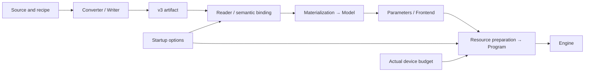

# NInfer Engine Architecture

This document defines NInfer's model instance, execution ownership and top-level control plane, and
explains how weights enter the fixed model implementation and how requests, resources and outputs
are committed together. It is the maintainer authority for the global architecture, the request
lifecycle and cross-module commit relationships.

This document specifies only long-term stable boundaries:

- who owns requests, ordering, cache policy and physical state;
- how architecture code, instance configuration, weight representation and actual execution connect;
- which stable states a request transitions between;
- when model state, output state and resource state may be published externally;
- how cancellation and failure reach a unique terminal state.

Resource selection and context cache policy are defined by
[Resource Scheduling and Context Cache](resource-scheduling-and-context-cache.md); KV pages, replicas,
block tables and the consumer contract are defined by [Paged KV Context Store](paged-kv-cache.md).

---

## 1. Product execution model

The NInfer Engine with the Generation purpose always runs:

- one GPU;
- one resident model instance;
- a `max_concurrency=1..8` fixed at startup;
- one bounded FIFO waiting queue;
- no preemption of already activated requests;
- each decode round groups all decode-ready requests into one compact batch.

Text, Vision, prefix reuse, MTP, DFlash2, CLI and HTTP serving all go through the public `ninfer::Engine` path.
MTP and DFlash2 are execution backends internal to Program and do not create a second request
scheduling or result publication mechanism.
An artifact must provide Text; the private weights and resources of Vision, MTP and DFlash2 may be absent.
Startup independently selects Vision and either none or one spec backend, and binds and prepares
resources only for the selected features and their shared dependencies.

The same public Engine also provides the CausalScoring purpose, fixed at startup. It serves only
offline text scoring: `CausalScoreCore` calls Program serially, and windows use temporary empty State
and Main KV; it creates no request, continuation, checkpoint or cache replica, and does not enter
Scheduler/ResourceManager. Generation and CausalScoring are not switched at runtime, and
scoring-specific staging is allocated only when CausalScoring starts.

`max_concurrency` limits the number of simultaneously active requests; it does not split shared KV
capacity evenly among lanes. A request enters Active only after Program proves that its complete
execution resources are guaranteed; once Active, it cannot lose the ability to complete because of
another request or the retention of inactive cache.

This document does not cover multi-GPU placement, active request preemption, priority/QoS,
cross-Engine context stores or large-scale continuous batching. These workloads require redefining
the admission and fairness contracts and cannot be extrapolated directly from the current
low-concurrency model.

### 1.1 Architecture and weight instances

Model code owns the mathematical formulas, call order, component handoffs and state transitions.
Config provides instance parameters such as layer count, dimensions, Attention/GDN distribution and
expert geometry. The current standard architecture entry points are `Qwen3_5ForCausalLM`,
`Qwen4ExpForCausalLM` and `Inkling2LoopForConditionalGeneration` (its Text backbone; a family of its
own under `src/models/inkling2/`, [Inkling 2 model](inkling2-model.md)); trained instances and physical weight assignment enter the corresponding
implementation as data.

A V3 artifact stores the configuration, physical objects, the Binding of logical parameters, the Use
at each use site, and Frontend resources. The Converter is responsible for source mapping, quantized
or value-preserving import, fused storage, packing and layout conversion; the loader validates, reads
and uploads the original bytes according to the actual binding. Swapping trained weights or combining
existing representations under the same architecture and a handleable configuration keeps using the
same model code.



`metadata.name` provides the public instance name and defaults to the architecture name; serving can
override the public alias with `--model-id`. These names and the conversion provenance identify the
data and its source. Execution choices are based on the architecture, configuration and actual binding.

For the file and reference contracts see [Container Specification](artifact-container.md); for the
numeric interpretation of weights and for planes see [Numeric Formats](tensor-formats.md) and
[Storage Layouts](storage-layouts.md), respectively.

---

## 2. Four execution boundaries

The request path has only four layers:

```text
Gateway
  │ product/protocol input
  ▼
Frontend
  │ PreparedPrompt / OutputSession
  ▼
Engine
  │ request order / lifecycle / publication
  ▼
Program
    physical resources / model execution
```

### 2.1 Gateway

Gateway is the CLI, the HTTP server or another product entry point, and owns:

- protocol parsing, connections and streaming transport;
- conversion of messages, tools and media into the public input;
- URL, path and data acquisition;
- response schema, usage and product-side errors;
- Gateway's own concurrency and connection lifecycle.

Gateway does not choose request order, cache source, active lane or KV page.

### 2.2 Frontend

Frontend owns the input and output semantics of the model family:

- tokenizer, chat template, Vision preprocessing and MRoPE prompt construction;
- the owning `PreparedPrompt` and its content identity;
- stop, thinking/content channel, detokenization, final text and model-private structured output;
- the prefix-execution boundary in model output that the history renderer can reconstruct exactly;
- the `OutputSession` owned exclusively by each request.

Frontend can preview the semantic effect that a model output will produce, but that effect can be
published only after Engine completes the commit. Frontend does not own the waiting queue, the cache
catalog or physical model state.

### 2.3 Engine

Engine is the request control plane and owns:

- outstanding capacity, FIFO queue and request deadline;
- request record, active slots, cancellation and response event;
- Scheduler and ResourceManager;
- orchestration of admission, prefill, decode, control, capture and terminal;
- the ordering of model commit, output commit and response publication;
- Engine-wide failure cleanup;
- Engine availability readable by Gateway; the fact itself is still owned only by EngineCore's
  failure/lifecycle state.

Engine understands requests, budgets, finish reasons and publishable output; it does not interpret
transformer layers, KV planes or allocators.

### 2.4 Program

Program is the physical execution entry point of the model instance and owns:

- active sequences and complete continuation state;
- State/KV stores, allocators, replicas, references and reservations;
- prefill, ordinary decode, MTP/DFlash2 and forced control;
- provisional model state and accepted-prefix commit/rollback;
- resident prefix identity, shortlist digest and committed execution provenance;
- resource feasibility, physical transitions and `ResourceResult`;
- workspace, CUDA Graph and fixed model calls;
- temporary State/KV and `lm_head`/logprob staging for CausalScoring windows.

Program does not maintain the FIFO, SessionIndex, cache retention value or user-visible output.

---

## 3. Unique ownership

| Fact or decision | Unique owner |
|---|---|
| config, binding, Use, weight backing and read-only resources | Model |
| native execution parameters derived from the same source as the binding | ModelInstance's const Parameters; borrows Model |
| protocol, connection, transport | Gateway |
| prompt and output semantics | Frontend |
| waiting queue, request record, response event | EngineCore |
| Engine availability | EngineCore; Gateway only reads it and maps it to external readiness |
| FIFO head, backfill, prefill/decode order, round membership | Scheduler |
| logical lane, cache catalog, session binding, retention policy | ResourceManager |
| model-output reconstruction-boundary semantics and preview state | Frontend |
| committed resident prefix execution provenance | Program; Engine only validates and carries the metadata |
| physical State/KV, reservation, placement, model state | Program |

Other components may read the stable summary published by the owner, but must not keep an
independently modifiable copy of the same kind of state.

### 3.1 Scheduler: decides only "who runs when"

Scheduler maintains:

- the current FIFO head;
- the staged-prefill owner;
- the fairness gates for admission, prefill and decode;
- the compact execution membership of each round;
- backfill protection for a blocked head.

Scheduler does not read checkpoint payloads, victim lists, resource vectors or allocator state.

### 3.2 ResourceManager: decides only "which logical context to retain"

ResourceManager maintains:

- logical lane state;
- the private/shared checkpoint catalog;
- SessionIndex and the prefix candidate index;
- retention class, hit observations and logical claims;
- the cache policy for admission, capture and finish.

It hands requests and cache candidates to Program for evaluation and adopts the complete physical
result that Program returns. It does not maintain a mirror of Device/Host bytes, page refcounts or
allocator free space.

### 3.3 Program: decides only "whether and how it can physically execute"

The real stores and allocators in Program are the sole authority on physical facts. Program:

- computes occupancy, sharing, reclamation and per-stage peaks from the complete candidate terminal state;
- seals an opaque `ResourcePlan` bound to the current `resource_revision`;
- executes the single physical transition;
- returns a complete result sufficient for ResourceManager to update the logical catalog.

Program does not decide cache value based on session, FIFO position or user identity.

### 3.4 Model instance and Engine lifetime

Engine interprets the logical requirements of the selected features according to the standard
architecture/config, and the binder maps them to the artifact's objects and Uses. The Materializer
establishes stable backing and uploads the original bytes, yielding a read-only Model. ModelInstance
holds the Model, forms const Parameters from it, and hands read-only resources such as the parsed
tokenizer to Frontend.

The Planner and actual execution borrow the same Parameters. The Planner queries the requirements of
each layer and of the selected backends for the startup range and builds a capacity curve; it resolves
KV capacity from the Device headroom left after the weights are resident, and then constructs
Program's final layout. GenerationCore or CausalScoreCore uses it once instance preparation is complete.

Model configuration, binding and weight addresses are fixed for the lifetime of the instance; each
Program exclusively owns its own mutable State/KV, workspace and Graph. On destruction, the Engine
core and pending device work are stopped first, then the instance's Program, Frontend and Parameters
are destroyed, and finally the Model backing is released. The Reader and upload staging belong to the
load lifecycle.

Weights, State/KV backing, block-table matrices, workspace and CUDA Graph resources are established
before Engine starts accepting requests. At runtime, ownership, mapping, frontier and replica placement
change, but these large Device allocations are not rebuilt.

### 3.5 Fixed execution and native parameters

The numbers of logical parameters, physical objects and Op parameters are determined by the math, the
storage and the actual entry point, respectively. For example, the two implemented forms of the
current Dense Attention projection:

| Actual binding | Fixed model call |
|---|---|
| One Q4 parent stores Q/K, another Q5 parent stores gate/V | Prepare two weight parameters and use the two-weight projection entry point |
| One complete FP8 or NVFP4 parent stores Q/K/gate/V in order | Prepare one weight parameter and use the single-weight projection entry point |

A View keeps the full parent's geometry, planes and element range; native preparation interprets
these references as the entry point requires. A shared object is resident only once, and each use
site keeps its own independent Use. The activation permissions are `A16Only={A16}`,
`AllowA8={A16,A8}` and `AllowA4={A16,A8,A4}`; a fused call takes the intersection of the permissions
of the relevant Uses and handles the required auxiliary values.

With `LoadOptions.tp=2`, Dense Qwen3.5 is sharded by logical parameter name at load time
(`qwen3_5/load/sharding.h`): Attention and GDN projections, MLP gate/up and `text/output_head` are
split by rows along head/intermediate width/vocabulary; output projections, MLP down,
`mtp/input_projection` and GDN convolution channels are split by columns; norms and
`text/token_embedding` are replicated; Vision is resident only on `vision_rank`; for DFlash2
placement see [Two-GPU tensor parallelism](tensor-parallel.md#2-weight-partitioning); Inkling 2 has its
own rules ([Inkling 2 model](inkling2-model.md#loading-and-two-rank-tensor-parallelism)).
Logical parameters on the same parent are combined into one parent placement. Model keeps one set of
views per device, and each device constructs its own Parameters; a DFlash2 drafter that reads the
whole head (full proposal head) is rejected under tp=2.

Model code directly maintains the finite set of call forms, cross-Op fusion and stage relationships;
closed computations and their shape/format dispatch belong to Ops. The Reader, binder, native
parameter preparation, capacity queries, warmup and actual execution each check the contracts they
consume. The executable range of a valid artifact depends on its actual consumers; conversion does not
require complete weight combinations to be registered in advance.

Mathematical formulas, weight representation values and implementation precision are interpreted
separately. Different quantization, prefill, batch or speculative paths may produce different results;
numerical and state correctness are verified against the [Op contract](op-development.md) and the
corresponding independent oracle.

---

## 4. Request and resource lifecycle

### 4.1 Request states

A request advances through the following stable states:

```text
Waiting
  -> Materializing
  -> Prefill
  -> DecodeReady | ControlReady
  -> TerminalPending
  -> Finished
```

- **Waiting**: has only the owning prompt and output state, and no Program sequence.
- **Materializing**: the resource transition has acquired the logical claim; the source stays valid
  until commit or abort.
- **Prefill**: the request is already Active and is consuming the prompt suffix.
- **DecodeReady**: can join the next compact decode round.
- **ControlReady**: Frontend requires a canonical forced-control suffix to be committed.
- **TerminalPending**: model execution has terminated, but the active resources have not yet
  completed retain or release.
- **Finished**: both resources and output have been committed, and the response can complete.

### 4.2 Logical lane states

ResourceManager's lane states are:

```text
Free -> Materializing -> Active -> TerminalPending -> Free
```

A request can enter Active only after both the physical and the logical result of materialization
have been successfully adopted. A terminal request must keep active ownership until a complete
checkpoint has been published or all active resources have been released.
A streaming request publishes `GenerationStart` once, after the admission choice is committed and
before any output delta; the prompt tokens and reused-prefix tokens in it are committed facts of the
resource choice and do not wait for prefill to complete.

Control lane, StateImage slot, KV execution row and decode batch row are distinct identities:

- a lane is Engine's long-lived active request position;
- State/KV execution resources are allocated by Program;
- a compact row is only an index within the current GPU unit.

Ownership must not be derived from one of them to another.

### 4.3 Gateway and Engine capacity

Gateway may acquire its own request lifetime before prepare or media acquisition. Engine outstanding capacity
starts when a request with nonzero output is successfully submitted, and is released jointly by two
independent facts:

```text
response_done       worker has formed the final result or error
consumer_released   wait has ended, or GenerationHandle has been abandoned

release_capacity =
    response_done && consumer_released && !capacity_released
```

The two may occur in either order, but capacity is released only once. Abandoning the request handle
only sets cancellation and `consumer_released`; it never calls Program from the consumer thread.

### 4.4 Continuation and session

An active continuation is writable model state; a published checkpoint is immutable reusable state.
A reusable checkpoint must prove complete State, Main KV, selected backend KV and the metadata needed
to continue execution, all at the same frontier.

A session key is only a lookup hint and does not own the continuation. Each request acquires a
monotonic `publication_order` when it enters Engine; only a completed result with a later order can
replace a SessionIndex binding.

---

## 5. Worker and scheduling

### 5.1 Single mutation owner

Only the Engine worker modifies the request record, Scheduler, ResourceManager and Program. Ingress,
consumer and transport threads interact through queues, the cancellation flag and response events,
and do not change model state directly.

A worker boundary processes, in semantic order:

1. receive timeouts or cancellations of waiting requests;
2. advance a resource transition that has already started;
3. complete TerminalPending requests that can be settled;
4. freeze the active cancellation snapshot;
5. attempt one admission when the fairness gate allows it;
6. choose staged prefill, forced control or compact decode;
7. run at most one model execution unit;
8. commit model, budget and Frontend output state;
9. publish response events and observations.

The concrete split of the loop may change, but the following ordering may not:

- an in-flight GPU unit must first reach a stable boundary before its resource mapping is modified;
- Program commit must precede publication of user output;
- a resource result must be adopted before a lane can change its visible state;
- while one global resource topology transition is unsettled, no other transition is started.

### 5.2 Admission order

Scheduler first determines the single waiting request that may be attempted, and ResourceManager
then chooses the cache and resource terminal state for it. Resource conditions cannot change FIFO
ownership in reverse.

When the FIFO head is temporarily blocked by active incumbents, Scheduler records the protected head
and the donor set that must finish. A later request can backfill only if Program proves the following
condition:

> with the borrower continuing to hold its complete active reservation, the established donor set
> finishing is still enough for the head to enter under a root plan that releases all inactive cache.

This proof does not use the timing assumption "the borrower is expected to finish first". A transition
that changes the global resource topology advances `resource_revision`, and any later backfill must be
proven again.

### 5.3 Prefill and decode

Scheduler guarantees:

- at most one staged-prefill request at a time;
- existing decode work is not starved by consecutive prefills;
- a decode round contains all and only the current decode-ready requests;
- a batch uses the exact `B` and is not padded with inactive lanes up to `max_concurrency`.

Program receives the compact `SequenceHandle[B]` and per-row budgets. Prefix reuse only reduces
materialization or suffix prefill; it does not create another scheduling path.

### 5.4 Admission invalidation

Only facts that can change the admission outcome trigger a new check:

- the waiting queue or FIFO head changes;
- a lane is released;
- the staged-prefill gate changes;
- a resource transition reaches its terminal state;
- Program's global resource revision changes.

Ordinary decode frontier advances, output publication and statistics updates do not scan the cache
catalog and do not rerun the pressure planner.

---

## 6. Two kinds of commit transactions

Engine orchestrates, across modules, two kinds of transactions that cannot replace each other.

### 6.1 Resource transition

A resource transition changes global resources or ownership at the following boundaries:

- waiting request materialization;
- active checkpoint capture;
- terminal retain or release;
- placement or deletion of an inactive checkpoint.

Paths that require planning, allocation or transfer follow:

```text
logical choice
  -> Program seals ResourcePlan
  -> RunningTransaction
  -> ResourceResult
  -> ResourceManager adopts result
```

`ResourcePlan` is bound to Program's `resource_revision`. A plan that becomes stale before start can be
replanned without side effects; after start, the source, victims or stage order cannot be changed.
Abort must also return a complete terminal state, so that every claim, pin and committed safe
degradation has a unique interpretation.

Resource candidates, feasibility formulas, the cost model and bounded search are defined by
[Resource Scheduling and Context Cache](resource-scheduling-and-context-cache.md).

### 6.2 Model-unit transaction

Prefill finalization, decode and control execution can produce a move-only `PendingBatch`:

```text
frozen sequence membership
provisional tokens
per-row produced extent
per-row accepted-prefix execution metadata
Program-owned provisional state
```

Engine runs a Frontend preview on each row's output, forms the accepted-prefix decision, and then
consumes the whole batch with a single `Program::commit` or `Program::abort_pending`. Program commits
or rolls back, together, the Main/backend KV, recurrent state, RNG and speculative state
corresponding to that prefix.

Non-cancelled rows obey:

```text
1 <= accepted_tokens <= produced_tokens
nonterminal -> accepted_tokens == produced_tokens
terminal    -> accepted_tokens may be a produced prefix
```

A cancelled row uses zero accepted tokens and enters terminal. Engine does not allow a still
unconsumed `PendingBatch` to be abandoned row by row.

### 6.3 Output publication order

The visible order of one model output is:

```text
Frontend preview
  -> Program commits accepted model state and resident prefix execution provenance
  -> terminal resource result, when required
  -> generation budget and scheduler accounting
  -> OutputSession commits preview
  -> publish stream/aggregate event
```

Therefore a consumer never sees a token that has not yet been committed, nor a continuation that is
inconsistent with the Program frontier.
Forced control uses the same commit order, but its tokens are provided by Frontend; it does not call
the sampler or advance the sampling RNG.

The boundary metadata produced by Frontend describes only relative positions within the current
accepted span. Engine verifies that it falls within that span and carries it with the corresponding
row; it does not interpret delimiters or modify the resident identity. Program converts it to absolute
positions using the pending row's base frontier and commits it atomically with the accepted tokens,
Main/backend state and prefix digest. When Program commit fails, the preview state of `OutputSession`
is likewise not committed; ordinary, MTP, DFlash2 and forced control share this ownership chain.

---

## 7. Terminal, cancellation and failure

### 7.1 Terminal

An Active request that terminates successfully first enters TerminalPending:

```text
choose retain or release
  -> Program publishes one complete checkpoint or releases the sequence
  -> ResourceManager adopts the terminal result
  -> optional SessionIndex update
  -> lane becomes Free
```

The checkpoint's logical publication slot was already reserved at activation. If retention cannot
form a complete continuation, the deterministic terminal state is release, rather than leaving the
request in TerminalPending.

### 7.2 Cancellation

Cancellation takes effect at a stable boundary of the Engine worker:

| State when cancellation is observed | Result |
|---|---|
| Waiting | Finish the request directly without creating Program state |
| Materializing | Abort the resource transition and adopt its complete result |
| Active | Once the current GPU unit is stable, enter TerminalPending and release |
| PendingBatch | Commit through a cancelled-row decision, or abort as a whole |
| Committed, not yet adopted | First adopt the committed result, then run the terminal path |

Cancellation does not modify an in-flight mapping, and does not publish a checkpoint from incomplete
active state.

### 7.3 Request-local rejection

Before Program mutation, it is possible to reject only the current request:

- queue timeout, overload or waiting cancellation;
- the input exceeds the public context contract;
- the prompt or generation request cannot be represented;
- the single request is still infeasible even with a root source and all inactive cache released.

### 7.4 Engine-wide failure

The following cases indicate that shared physical state can no longer be safely interpreted, and the
whole Engine must fail:

- after a GPU mutation, neither commit nor a stable abort is possible;
- `PendingBatch` membership or disposition is inconsistent;
- handle owner/generation mismatch;
- a resource, checkpoint completeness or noexcept adoption invariant is broken.

Cleanup must first terminate pending resource/model transactions in Program, then release active
state, and finally clear ResourceManager and complete all request responses. Internal invariant
errors must not be downgraded to a cache miss, a wait or a retry.

---

## 8. Top-level constraints on physical execution

The following constraints belong to the Engine architecture, but their concrete implementation is
defined by Program and lower-level documents:

- Program establishes a fixed number of control/state/table resources at startup;
- growing KV is backed by shared paged pools, and an active request holds a complete growth reservation;
- State/KV mapping stays stable within one GPU execution unit;
- CUDA Graphs are built per valid exact-`B` topology; request identity and page IDs are stable input
  data, not graph keys;
- ordinary decode does not run a catalog scan, pressure search or background replica scan;
- workspace is backing planned as a whole by Program at startup; Vision, Text and the speculative
  schedule use its internal regions according to mutually exclusive lifetimes.

An Op owns Graph update compatibility within its declared execution range; Program captures the
complete execution unit and validates updates of same-kind definitions at startup. Length tiers are
used to bound reserved resources and are not the same as topology classes. Program does not replicate
the private kernel dispatch boundaries of target attention; the actual topology requirements of other
Ops, such as draft, are still handled separately by the complete execution unit.

Capacity queries consume the same per-layer parameters and Uses as execution. Allocation scopes are
used both for layout computation and for actual execution; sequentially exclusive scratch is counted
at its peak, and data still live across stages is counted for its full lifetime. The Vision handoff is
kept until the last consumer among Text and the selected MTP, and speculative pending features and
verify records are kept until the corresponding commit boundary.

Prefill cost selects measured values by hardware class and by the `prefill_signature` derived from the
actual Text/Vision configuration, binding and Uses; when there is no matching value, a generic cost is
used. Costs are used for planning choices; physical feasibility is still decided by Program's actual
layout and occupancy.

### 8.1 Two-GPU tensor parallelism

For the complete design (weight partitioning, transfers, two-device CUDA Graph, mirrored state, tests
and known limitations) see [Two-GPU tensor parallelism](tensor-parallel.md).

With `EngineOptions.tp = 2`, Engine creates one `DeviceContext` for each rank in `devices`, forms
an `ExecutionContext` from them, and enables peer access when the driver allows it (otherwise
collectives copy via host staging; in CUDA Graphs, the all-reduce with a single active request is
exchanged through a pinned host mailbox).
Loading yields one two-device Model; `ModelInstance` holds the `execution::Parameters` of rank 0 and
rank 1.
Scheduler, ResourceManager, admission, sampling and request output still exist only on rank 0, and
Engine semantics are the same as on a single GPU.

Program has only one set of logical stores (KV address space, pages, StateImage, catalog), held by
rank 0. rank 1 allocates in `ProgramImpl::PeerRuntime` the same per-rank persistent/workspace layout
as rank 0 (with KV heads, GDN channels and value heads halved), and its KV page pool, execution tables
and StateImage pool are attached at construction as mirrors of the rank 0 pools: every page
zero/copy, row acquire/release/publish and slot zero/copy on rank 0 is replayed on rank 1's stream
with the same physical index. The Host tier has no rank 1 copy, so tp 2 requires Host State and Host
KV capacity of 0. Every bind, prefill step and forced-token prefill publishes the same prefill KV row
on both ranks; decode uploads the same host ingress to the frames of both ranks. CUDA Graph forks/joins
rank 1's stream into the same capture on rank 0, and before launch gates on rank 1's committed mirror
work. Both ranks keep the same runtime reservation, and KV capacity is solved for the rank with less
free device memory. Currently supported: ordinary, MTP and DFlash2 (requires `--lm-head-draft`)
generation and CausalScoring, optionally with Vision, with KV in
`bf16`/`int8`/`nvfp4`. The Vision tower and encode workspace exist only on
`vision_rank` (`--vision-device`): that rank encodes every item, the merged embeddings are copied by
the other rank's stream, ordered by events, into its own handoff, and each rank scatters its own copy;
the other rank allocates no encode region, and the difference is added back to its budget when solving
KV. Prefix reuse is the same as on a single GPU, including zero-suffix and the MTP
bridge: under MTP, rank 1 keeps its own copy of the target hidden in the same StateImage slot, and the
first token of a zero-suffix is sampled through the vocabulary-sharded output head. For the
reclamation rule of private prefill capture when there is no Host tier, see
[Resource Scheduling and Context Cache](resource-scheduling-and-context-cache.md#101-retention-policy).

Serve warmup uses the same public Engine execution path, but its request-level context cache is always
disabled. Warmup may establish runtime state for CUDA Graph, libraries and allocators; when it finishes
it must not leave behind any continuation that external requests could hit, nor occupy the
checkpoint catalog.

---

## 9. Core invariants

1. Request order is decided only by Scheduler.
2. Logical cache policy is decided only by ResourceManager.
3. Physical occupancy, reservation, feasibility and model state are decided only by Program.
4. Before Active publication, a complete continuation and the completion reservation must be in place.
5. There is at most one global resource topology transition at any time.
6. A `PendingBatch` must be fully consumed by a single Program commit or abort.
7. Model output becomes visible to the consumer only after Program, Frontend and budget have all committed.
8. A request's active ownership must not be released or reused before TerminalPending ends.
9. Cancellation can change request state only at a linearized worker boundary.
10. Every accepted request, resource transaction and model transaction has a finite and unique terminal state.

---

## 10. Implementation locations and adjacent authorities

| Responsibility | Main location |
|---|---|
| Public Engine facade | `include/ninfer/engine.h`, `src/runtime/engine/engine.cpp` |
| Engine worker and request lifecycle | `src/runtime/engine/engine_core.h`, `src/runtime/engine/request_record.h` |
| Scheduler | `src/runtime/engine/scheduler.h`, `admission_policy.*` |
| Instance construction and lifetime | `src/runtime/engine/model_instance.*` |
| ResourceManager and materialization planner | `src/runtime/engine/context_cache/` |
| Request, execution, resource and timing contracts | `src/runtime/contract/` |
| Model config, binding and read-only data | `src/models/qwen3_5/config.*`, `load/`, `model.*` |
| Native parameters and fixed model calls | `src/models/qwen3_5/execution/` |
| Program planning, storage and transactions | `src/models/qwen3_5/program/` |
| Frontend and model state layout | `src/models/qwen3_5/frontend/`, `state/` |
| Inkling 2 family (config, loading, forward, state, Program, frontend, Engine family) | `src/models/inkling2/` ([Inkling 2 model](inkling2-model.md#where-things-are)) |
| device primitives, tensors/views, checked layouts, arenas, graph RAII, physical KV, raw transfers | `src/core/` |
| generic `.ninfer` framing, descriptors, binding primitives, materialization | `src/artifact/` |
| semantic Ops | `src/ops/`, `include/ninfer/ops/` |
| shared JSON/message-to-owning-input adapter | `src/product/prompt_input/` |
| media URL/path/data acquisition | `src/product/media_acquire/`, CLI and serving |
| media decode from already-owned bytes | `src/media/decode/` |
| HTTP Gateway | `src/serve/` |
| Source adaptation, recipes and conversion methods | `tools/convert/` |
| Python container reading, encoded output and writer | `tools/artifact/` |

These paths locate the current authority; they do not freeze the file split into an external interface.

`include/ninfer/engine.h` and `include/ninfer/types.h` are the opaque Engine interface and owning host
values used by in-tree applications; NInfer currently does not install or export a C++ SDK.
`include/ninfer/ops/` holds the repository-internal semantic Op contracts. `.ninfer` is the only C++
product artifact; other formats are not loaded through extension detection, compatibility shims or a
second product entry point. The CLI, server and inference benchmark run inference only through the
public Engine; the converter provides no Python model-inference route.

The artifact layer owns the generic file and residency contracts, the model implementation owns the
math and state operations, runtime owns the public runtime contracts and Engine publication policy,
and product/serving owns input acquisition and protocol translation. Every semantically closed Op
(including fused, fixed-shape and device-specialized implementations) belongs to `src/ops`.

Adjacent documents:

- [Resource Scheduling and Context Cache](resource-scheduling-and-context-cache.md): resource vector,
  checkpoint capability, pressure planning and physical transition;
- [Paged KV Context Store](paged-kv-cache.md): typed pools, logical pages, replicas, block tables
  and consumer address contract;
- [Op development](op-development.md): admission criteria for Op correctness and performance;
- [CLI](../cli.md) and [HTTP serving](../serving.md): external behavior.
